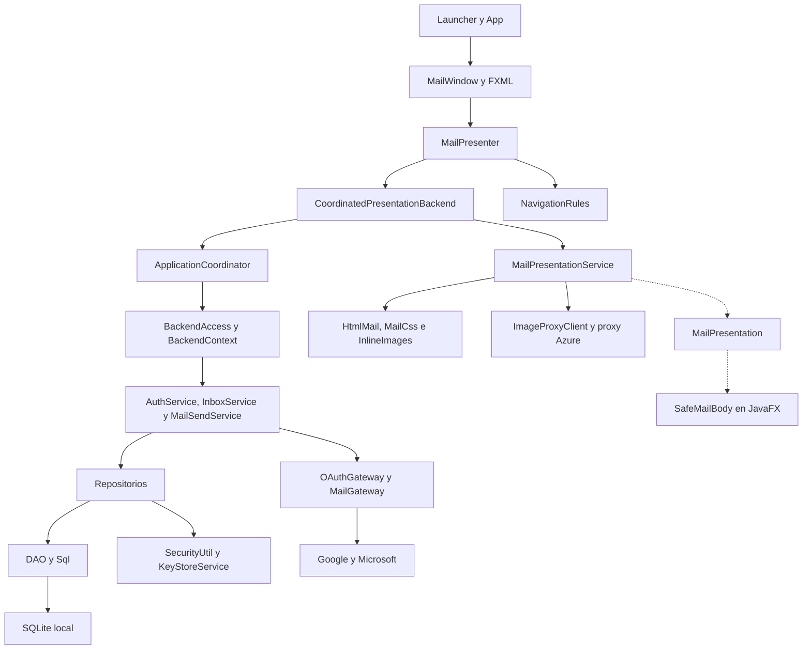

# Arquitectura de Evermail: guía de lectura

Referencia del código revisada el 17 de octubre de 2026. Esta guía explica la implementación actual y sus motivos; las propuestas futuras permanecen separadas en [requisitos](../requisitos/pendientes-versiones.md).

## Una vista del conjunto

Las flechas continuas resumen uso/dependencia; las discontinuas muestran entrega de contenido. No indican que todas las llamadas ocurran simultáneamente. El cuerpo se obtiene a través del coordinador, mientras que las imágenes tienen una fase posterior separada.

## Qué problema resuelve cada capa

| Capa                          | Qué hace                                                 | Por qué existe                                                         |
| ----------------------------- | -------------------------------------------------------- | ---------------------------------------------------------------------- |
| `ui`                          | Controles, FXML y representación del estado              | La ventana cambia sin mezclar sus eventos con SQL o protocolos.        |
| `presentation`                | Acciones, estados y tratamiento de respuestas asíncronas | Permite probar lo que verá el usuario sin abrir JavaFX.                |
| `navigation`                  | Decide la ruta válida para la sesión                     | Evita que una pantalla privada sobreviva a una sesión invalidada.      |
| `application`                 | Planifica trabajo, invalida sesiones y espera cierres    | Da un dueño al ciclo de vida y a las operaciones pendientes.           |
| `service`                     | Casos de uso y adaptadores OAuth/IMAP/SMTP               | Separa las decisiones de aplicación de los controles visuales.         |
| `repository`                  | Vincula cuenta, objetos, cifrado y transacciones         | Evita que cada servicio repita las reglas de almacenamiento.           |
| `dao`                         | Filas y consultas JDBC                                   | Concentra consultas reutilizadas; también existe SQL en repositorios.  |
| `model`                       | Valores de dominio y transporte                          | Define los datos intercambiados sin depender de controles JavaFX.      |
| `config`, `exception`, `util` | Límites, errores y transformaciones                      | Mantiene políticas y operaciones reutilizadas identificables.          |
| `facade`, `controller`        | Tareas JavaFX y lector independiente                     | Conserva una integración existente distinta del camino principal.      |
| `diagnostics`                 | Entradas de diagnóstico y medición                       | Ayuda a distinguir fallo de autorización, red, descarga o preparación. |

La separación es útil para aprender, pero no es absoluta: por ejemplo, los repositorios usan tanto DAO como `Sql` directamente, y `AccountCoordinator` puede mantener su bloqueo durante una operación de red. Los diagramas describen esas decisiones reales, no una arquitectura idealizada.

## Recorrido recomendado

1. [Sesión, concurrencia y cierre](sesion-y-concurrencia.md): quién ejecuta cada trabajo y cómo se descartan resultados antiguos.
2. [Lectura, MIME y caché](lectura-y-cache.md): cómo pasa un correo remoto a contenido seguro visible.
3. [Envío y recuperación](envio-y-recuperacion.md): qué significa un envío incierto y por qué no se reenvía automáticamente.
4. [Persistencia y seguridad](persistencia-y-seguridad.md): transacciones, claves, migraciones y límites del cifrado.
5. [Sintaxis y validación de diagramas](sintaxis-diagramas.md): cómo interpretar y revisar los Markdown.

## Diagramas por responsabilidad

| Área                            | Diagrama                                      |
| ------------------------------- | --------------------------------------------- |
| Arranque y lector independiente | [Controladores](diagramas/uml-controllers.md) |
| Ciclo de aplicación             | [Application](diagramas/uml-application.md)   |
| Estado visual                   | [Presentation](diagramas/uml-presentation.md) |
| Rutas                           | [Navigation](diagramas/uml-navigation.md)     |
| Controles JavaFX                | [UI](diagramas/uml-ui.md)                     |
| Casos de uso y protocolos       | [Servicios](diagramas/uml-service.md)         |
| Almacenamiento de objetos       | [Repositorios](diagramas/uml-repositories.md) |
| Consultas y filas               | [DAO](diagramas/uml-dao.md)                   |
| Datos intercambiados            | [Modelos](diagramas/uml-model.md)             |
| Adaptadores Task                | [Fachadas](diagramas/uml-facade.md)           |
| Políticas y plazos              | [Configuración](diagramas/uml-config.md)      |
| Fallos                          | [Excepciones](diagramas/uml-exception.md)     |
| Transformación de contenido     | [Utilidades](diagramas/uml-util.md)           |
| Mediciones                      | [Diagnóstico](diagramas/uml-diagnostics.md)   |
| Esquema físico                  | [ER](../datos/diagramas/er-diagram.md)        |

Las clases de otros paquetes se muestran cuando ayudan a entender una relación, sin repetir su contrato completo. Los tipos anidados se explican junto al diagrama; las colecciones y retornos genéricos se abrevian donde una firma completa dificultaría la lectura.
