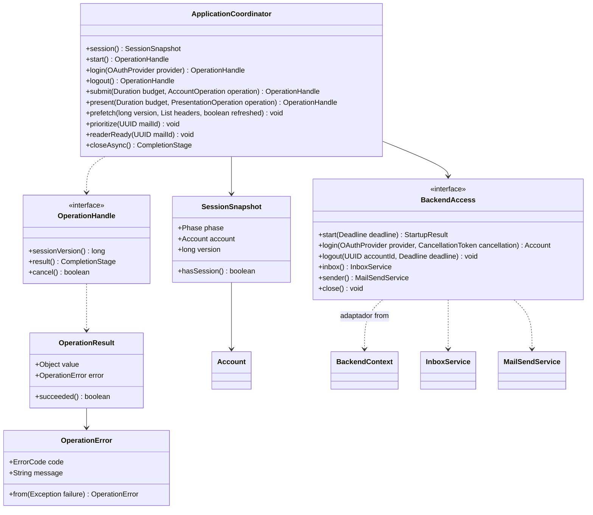

# Coordinación de aplicación y sesión

Referencia de la implementación revisada el 17 de octubre de 2026. Se muestran responsabilidades y contratos seleccionados; no todos los miembros privados ni las sobrecargas. Las clases externas al paquete se incluyen solo para explicar dependencias.

Los valores de los records se muestran como datos accesibles mediante sus accesores. `Object`, `OperationHandle` y `CompletionStage` abrevian sus parámetros genéricos. `BackendFactory`, `AccountOperation` y `PresentationOperation` son interfaces funcionales anidadas del coordinador.

Un trabajador ejecuta operaciones de cuenta; otro ejecuta preparación de imágenes. El límite predeterminado es 32 operaciones pendientes, con una plaza reservada para la transición de sesión. La cola de precarga contiene hasta 100 identificadores y alimenta el trabajador de cuenta uno por uno cuando no hay trabajo de primer plano ni lector prioritario. REFRESH sustituye pendientes; MORE agrega. Un fallo distinto de MAIL_NOT_FOUND vacía los pendientes.

Cada transición invalida resultados anteriores aumentando `version`. Cancelar solicita interrupción y el resultado se completa cuando el trabajo deja de usar sus recursos. Logout no ofrece cancelación individual porque puede haber comenzado a eliminar datos. `closeAsync` espera a los trabajadores antes de cerrar y limpiar el backend.

`BackendAccess.from` restaura mediante `StartupService` y limpia la caché INBOX al arrancar; al cerrar vuelve a limpiarla si hubo inicialización. No borra cuentas, claves ni envíos. Esto permite recuperar restos de un cierre forzado sin reactivar contenido de otra ejecución.

Para entender prioridades, plazos y cierre con ejemplos: [sesión y concurrencia](../sesion-y-concurrencia.md). Fuente: [paquete application](../../../src/main/java/com/juanpablo/evermail/application).
