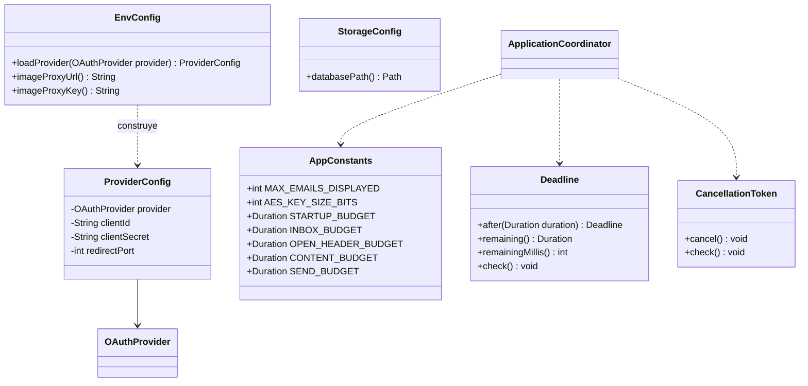

# Configuración y límites de ejecución

Referencia de la implementación revisada el 17 de octubre de 2026. Se muestran responsabilidades y contratos seleccionados; no todos los miembros privados ni las sobrecargas. Las clases externas al paquete se incluyen solo para explicar dependencias.

## Para qué existe

`EnvConfig` lee entorno y `.env` opcional y valida el proveedor solicitado. `ProviderConfig` contiene la configuración particular del cliente; los endpoints, scopes y servidores pertenecen a `OAuthProvider`, en `model`. Microsoft puede elegir servidor SMTP según la identidad validada. Los secretos no deben presentarse como datos de interfaz.

`StorageConfig.databasePath()` devuelve `%APPDATA%/Evermail/evermail.db`, fuera del directorio de instalación. Separar datos y ejecutable permite actualizar binarios sin confundirlos con la caché. No existe una clase `ExecutionConfig`: los ejecutores se construyen en el coordinador y en el servicio de presentación.

## Límites actuales y significado

| Constante                                       | Valor           |
| ----------------------------------------------- | --------------- |
| MAX_EMAILS_DISPLAYED                            | 50 por página   |
| STARTUP_BUDGET                                  | 5 s             |
| INBOX_BUDGET                                    | 30 s            |
| OPEN_HEADER_BUDGET                              | 2 s             |
| CONTENT_BUDGET                                  | 30 s            |
| SEND_BUDGET                                     | 60 s            |
| OAUTH_AUTHORIZATION_TIMEOUT                     | 3 min           |
| TOKEN_REFRESH_MARGIN                            | 60 s            |
| AES_KEY_SIZE_BITS                               | 256             |
| MAX_BODY_BYTES                                  | 1 MiB           |
| MAX_INLINE_IMAGE_BYTES / MAX_INLINE_TOTAL_BYTES | 512 KiB / 2 MiB |
| MAX_MIME_PARTS / MAX_HTML_NODES                 | 256 / 20 000    |

Son límites configurados, no resultados de rendimiento. En `ApplicationCoordinator.submit` y las tareas de las fachadas, el plazo se crea al comenzar la ejecución: **la espera en cola no se descuenta**. Los pasos de una operación reciben el plazo restante; la segunda fase de imágenes dispone de una operación y un plazo propios. Una cancelación solicita interrupción, pero no deshace efectos ya realizados.

Fuente: [paquete config](../../../src/main/java/com/juanpablo/evermail/config). Configuración práctica: [OAuth](../../desarrollo/configuracion-oauth.md) y [proxy](../../desarrollo/proxy-imagenes.md).
