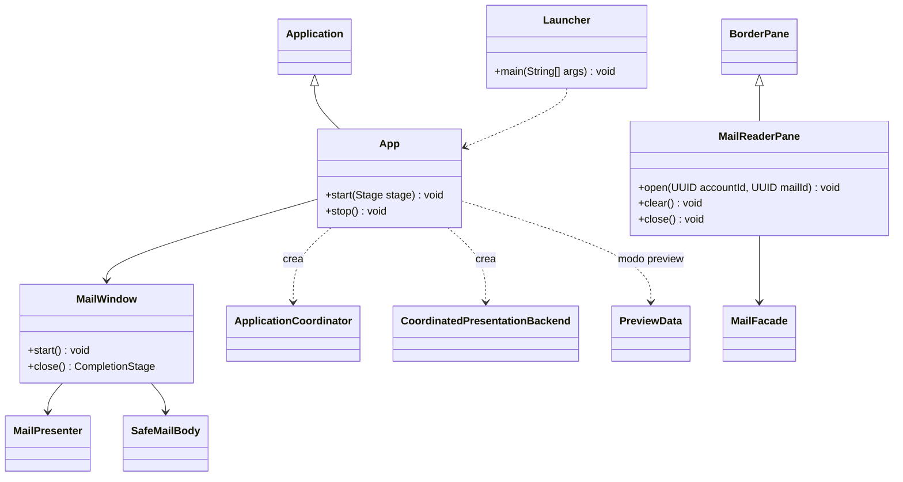

# Arranque de la interfaz y lector independiente

Referencia de la implementación revisada el 17 de octubre de 2026. Se muestran responsabilidades y contratos seleccionados; no todos los miembros privados ni las sobrecargas. Las clases externas al paquete se incluyen solo para explicar dependencias.

## Dos caminos que no deben confundirse

El arranque normal crea `ApplicationCoordinator`, su adaptador `CoordinatedPresentationBackend` y `MailWindow`. La ventana crea el presentador y aplica estados en JavaFX. Los componentes FXML y sus responsabilidades están en [UI](uml-ui.md); las rutas están en [navegación](uml-navigation.md).

El paquete **`controller`**, en singular, contiene `MailReaderPane`: un lector independiente que consume `MailFacade`. No es el visor utilizado por `MailWindow`, que usa `SafeMailBody`. Mantener ambos en el dibujo permite localizar el componente existente sin atribuirle el flujo principal. El nombre histórico de este archivo se conserva para no romper enlaces.

Con `--preview`, `App` carga una composición FXML y `PreviewData` proporciona ejemplos, sin arrancar el backend. Sirve para revisar diseño sin una cuenta real. Véase [previsualización](../../desarrollo/previsualizar-interfaz.md).

Al cerrar normalmente, `MailWindow.close()` espera de forma asíncrona el cierre del presentador y comunica fallos; `App.stop()` también solicita cierre. Los detalles y diferencias frente a logout se explican en [sesión y concurrencia](../sesion-y-concurrencia.md).

Fuente: [App](../../../src/main/java/com/juanpablo/evermail/App.java) y [MailReaderPane](../../../src/main/java/com/juanpablo/evermail/controller/MailReaderPane.java).
