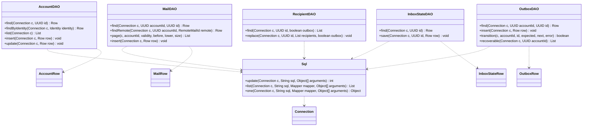

# DAO y filas de persistencia

Referencia de la implementación revisada el 17 de octubre de 2026. Se muestran responsabilidades y contratos seleccionados; no todos los miembros privados ni las sobrecargas. Las clases externas al paquete se incluyen solo para explicar dependencias.

## Cómo leer los tipos

`AccountRow`, `MailRow`, `OutboxRow` e `InboxStateRow` son alias visuales de las clases anidadas `AccountDAO.Row`, `MailDAO.Row`, `OutboxDAO.Row` e `InboxStateDAO.Row`; no son archivos independientes. `List`, `Object` y `Object[]` abrevian genéricos y varargs para mantener legible el diagrama. `Sql.Mapper` convierte cada fila de JDBC.

Los DAO reciben una `Connection` ya coordinada: no deciden cuándo confirmar, revertir ni cerrar. Esto permite guardar una página, sus destinatarios y su cobertura dentro de la misma transacción. `RecipientDAO` atiende ambas tablas de destinatarios mediante el parámetro `outbox`; no hay dos DAO separados.

`MailDAO.Row` combina encabezado, cuerpo cifrado y formato de cuerpo. Los repositorios realizan parte de las actualizaciones directamente con `Sql`; el DAO no concentra todo el SQL del proyecto. `Sql` parametriza valores; la elección de tablas en `RecipientDAO` procede del booleano, no de texto introducido por el usuario.

La infraestructura de conexión y transacciones se muestra en [repositorios](uml-repositories.md). El [ER](../../datos/diagramas/er-diagram.md) describe tablas, no objetos Java.

Fuente: [paquete dao](../../../src/main/java/com/juanpablo/evermail/dao).
