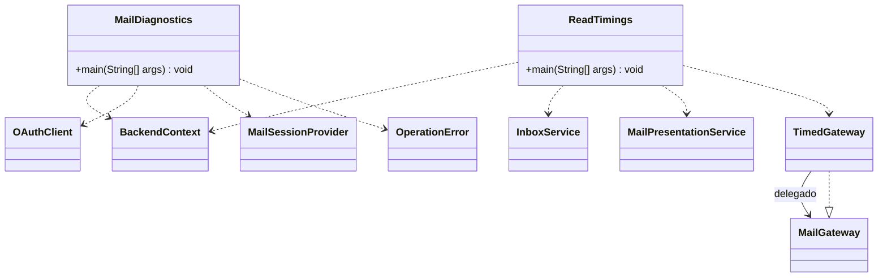

# Diagnóstico y medición

Referencia de la implementación revisada el 17 de octubre de 2026. Se muestran responsabilidades y contratos seleccionados; no todos los miembros privados ni las sobrecargas. Las clases externas al paquete se incluyen solo para explicar dependencias.

`TimedGateway` es un record privado anidado en `ReadTimings`. Envuelve el transporte para medir conexión y obtención MIME sin modificar el servicio normal.

`diagnoseMail` renueva tokens de cuentas guardadas, consulta metadatos IMAP y autentica SMTP **sin enviar un mensaje**. Puede actualizar credenciales locales; no es una prueba sin efectos ni demuestra entrega SMTP. Los diagnósticos muestran códigos y categorías controladas, no cuerpos ni tokens.

`measureMailReads` busca hasta tres encabezados locales sin cuerpo y mide su primera descarga y reapertura. Guarda cuerpos cifrados, no marca leído y no renderiza la ventana. Si no hay encabezados elegibles, produce cero muestras; con la limpieza de bandeja al cerrar es un caso esperable. No compara automáticamente todas las cuentas o proveedores.

Estas herramientas son puntos de entrada separados: usan `BackendContext` directamente y no recorren el ciclo de limpieza de `BackendAccess` de la ventana. Los tiempos del backend no equivalen al tiempo hasta la última imagen visible en JavaFX.

Uso e interpretación: [verificación de correo](../../desarrollo/verificacion-correo.md) y [mediciones](../../pruebas/tiempos-lectura.md). Fuente: [paquete diagnostics](../../../src/main/java/com/juanpablo/evermail/diagnostics).
