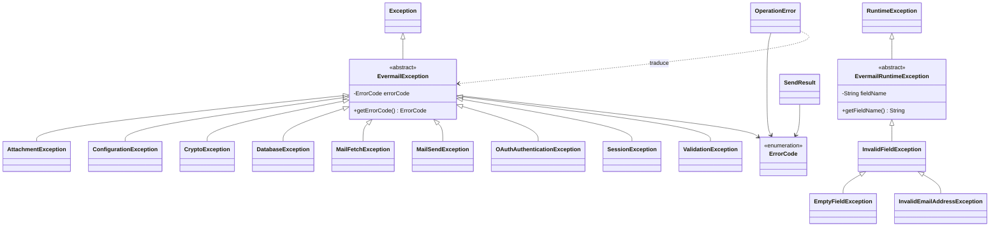

# Excepciones y errores visibles

Referencia de la implementación revisada el 17 de octubre de 2026. Se muestran responsabilidades y contratos seleccionados; no todos los miembros privados ni las sobrecargas. Las clases externas al paquete se incluyen solo para explicar dependencias.

Existen dos jerarquías: `EvermailException` es comprobada y contiene `errorCode`; `EvermailRuntimeException` es no comprobada y contiene `fieldName`. No existe el atributo `retryable` en la base actual. Lombok genera sus getters. Que una excepción permanezca en el paquete no significa que todas las funciones relacionadas, como adjuntos, estén habilitadas.

`OperationError.from` traduce fallos a mensajes controlados; no copia a la interfaz el mensaje arbitrario del proveedor. Algunos códigos distinguen permisos OAuth, conexión IMAP, SMTP, almacenamiento y cancelación. El catálogo completo está en [ErrorCode.java](../../../src/main/java/com/juanpablo/evermail/exception/ErrorCode.java), evitando mantener una segunda enumeración que se desactualice.

Un resultado asíncrono exitoso solo significa que la operación devolvió un valor: si ese valor es `SendResult`, todavía hay que interpretar `DeliveryState`. UNKNOWN no autoriza reenviar. Para ejemplos de fallos y recuperación, consulta [envío](../envio-y-recuperacion.md) y [sesión](../sesion-y-concurrencia.md).

Fuente: [excepciones](../../../src/main/java/com/juanpablo/evermail/exception) y [OperationError](../../../src/main/java/com/juanpablo/evermail/application/OperationError.java).
