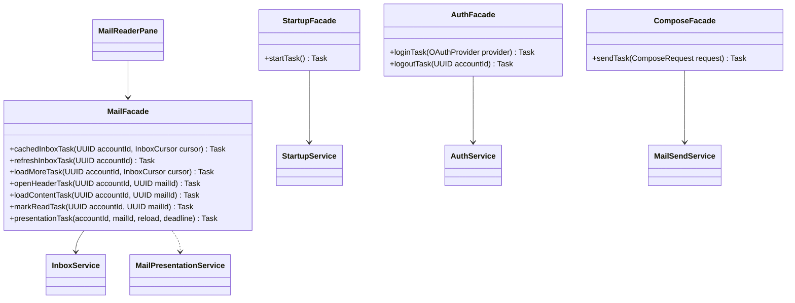

# Fachadas JavaFX existentes

Referencia de la implementación revisada el 17 de octubre de 2026. Se muestran responsabilidades y contratos seleccionados; no todos los miembros privados ni las sobrecargas. Las clases externas al paquete se incluyen solo para explicar dependencias.

Las fachadas crean `javafx.concurrent.Task` sin ejecutarlas. El retorno `Task` abrevia el parámetro de resultado: por ejemplo `Task<InboxPage>`, `Task<MailContent>` o `Task<SendResult>`. El llamador elige el ejecutor y maneja `value` o `exception`.

Su utilidad es adaptar servicios síncronos a JavaFX. Los plazos ordinarios nacen dentro de `call()`; `presentationTask` recibe el plazo compartido del llamador y permite recuperación explícita mediante `reloadContent`.

No existe `TaskRunner` en el código. Tampoco son estas fachadas el camino principal de `MailWindow`: ese camino usa [presentation](uml-presentation.md) y [application](uml-application.md). `MailReaderPane` sí consume `MailFacade`. Esta distinción explica por qué conviven dos formas de adaptación sin dibujarlas como si se ejecutaran ambas en cada apertura.

Fuente: [paquete facade](../../../src/main/java/com/juanpablo/evermail/facade).
