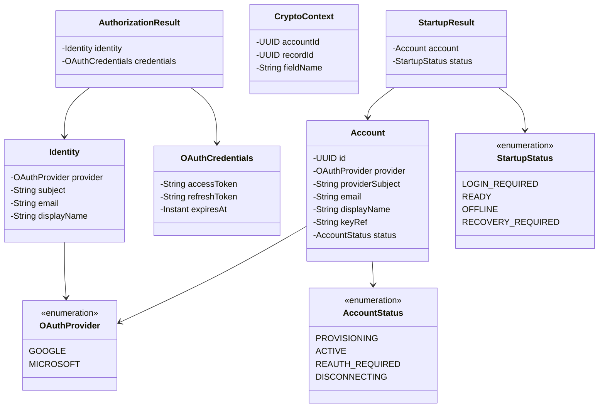
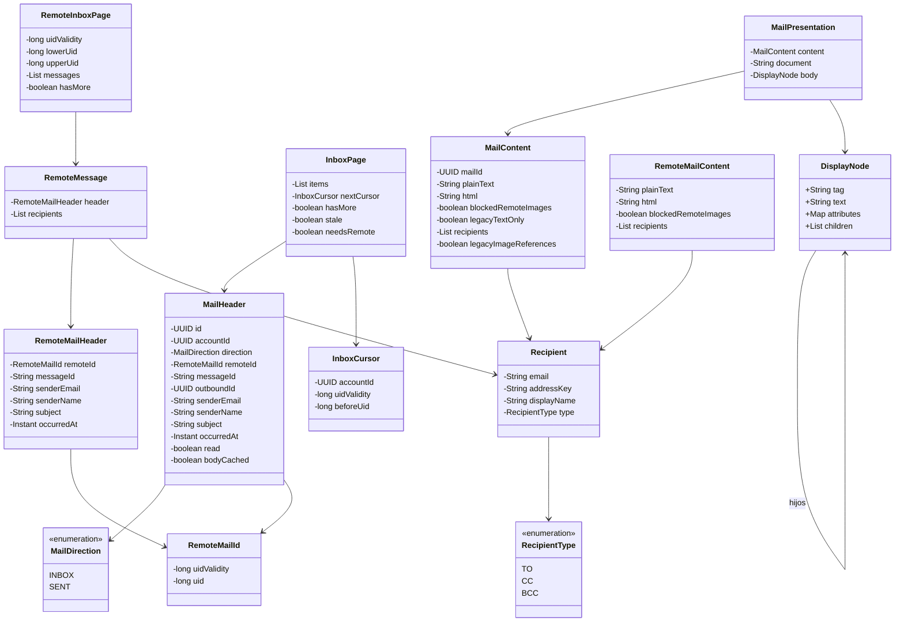
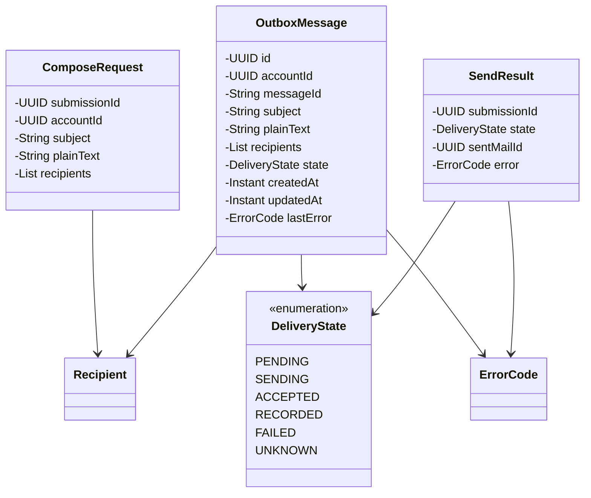

# Modelos de dominio y transporte

Referencia de la implementación revisada el 17 de octubre de 2026. Se muestran responsabilidades y contratos seleccionados; no todos los miembros privados ni las sobrecargas. Las clases externas al paquete se incluyen solo para explicar dependencias.

## Identidad y credenciales

Los modelos de este paquete son valores; Lombok genera getters en las clases anotadas con `@Value`. `Identity` representa la identidad validada por OIDC; `Account` añade identidad local, estado y referencia de clave. `AuthorizationResult` une identidad y credenciales durante el acceso. `CryptoContext` identifica cuenta, registro y campo para autenticar el cifrado.

`OAuthProvider` también contiene configuración de endpoints, scopes y servidores. Se muestran sus dos valores para no mezclar configuración de proveedor con todos los campos de dominio. Las credenciales no se entregan a los controles ni se incluyen en `toString`.

## Bandeja, contenido y representación

`List` y `Map` abrevian colecciones genéricas; las flechas indican el tipo de elemento relevante. `DisplayNode` es el record anidado `MailPresentation.DisplayNode`: captura el DOM saneado para actualizar imágenes en JavaFX sin preparar HTML en el hilo visual.

Los tipos `Remote*` proceden de IMAP y no tienen el UUID de un correo local. El repositorio vincula `RemoteMailId` —UIDVALIDITY y UID— con la cuenta y el UUID local. `InboxCursor` incluye cuenta, generación y límite de UID: no es un número de página intercambiable entre buzones.

`bodyCached` indica disponibilidad del cuerpo; no garantiza imágenes externas descargadas. `legacyTextOnly` permite identificar cuerpos antiguos en texto, y `legacyImageReferences` señala HTML cuyo sobre tiene referencias anteriores a la versión 2. `MailPresentation` es un resultado para mostrar, no una tabla persistente.

## Composición y envío

`ComposeRequest` lleva `submissionId` para reconocer el mismo intento. `OutboxMessage` es el intento persistido y recuperable; `SendResult` informa su resultado, que puede ser incierto. `sentMailId` solo existe cuando hay registro local del enviado. Mantener separados estos modelos evita tratar un formulario editable como si ya fuera una entrega confirmada.

La estructura física está en el [ER](../../datos/diagramas/er-diagram.md). El motivo de los estados de envío se explica en [envío y recuperación](../envio-y-recuperacion.md). Fuente: [paquete model](../../../src/main/java/com/juanpablo/evermail/model).
