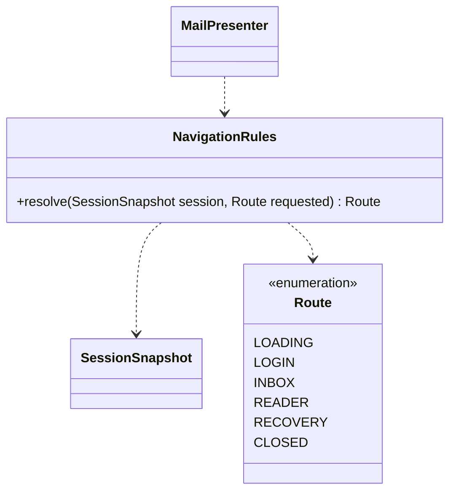
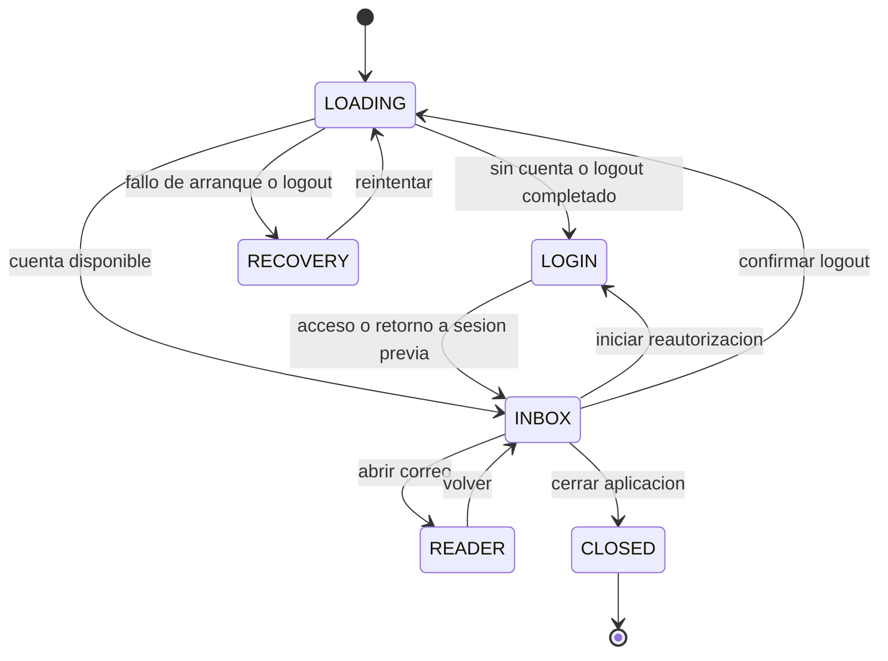

# Reglas de navegación

Referencia de la implementación revisada el 17 de octubre de 2026. Se muestran responsabilidades y contratos seleccionados; no todos los miembros privados ni las sobrecargas. Las clases externas al paquete se incluyen solo para explicar dependencias.

La navegación es una función de estado, no un cargador FXML. `Route` es una enumeración anidada en `NavigationRules`. Separarla permite decidir qué vista es válida aunque la interfaz aún no haya aplicado el cambio.

| Fase de sesión                             | Ruta resultante                           |
| ------------------------------------------ | ----------------------------------------- |
| NEW, STARTING, LOGGING_OUT                 | LOADING                                   |
| LOGIN_REQUIRED, AUTHENTICATING             | LOGIN                                     |
| FAILED                                     | RECOVERY                                  |
| CLOSED                                     | CLOSED                                    |
| READY, OFFLINE, REAUTH_REQUIRED con cuenta | READER si se solicita; INBOX en otro caso |
| Las tres fases anteriores sin cuenta       | LOGIN                                     |

## Recorridos principales

El dibujo resume recorridos; la tabla determina la resolución exacta de cada fase. El cierre de aplicación es posible desde cualquier ruta: se dibuja desde INBOX para no repetir la misma transición. Logout también puede solicitarse desde el lector. Un acceso fallido sin sesión previa permanece en LOGIN.

La redacción es un panel de la vista principal, no una ruta COMPOSE. CLOSED invalida la sesión visual, pero el futuro de cierre aún puede estar esperando recursos: no significa por sí solo que la limpieza terminó.

Fuente: [NavigationRules](../../../src/main/java/com/juanpablo/evermail/navigation/NavigationRules.java) y [SessionSnapshot](../../../src/main/java/com/juanpablo/evermail/application/SessionSnapshot.java).
