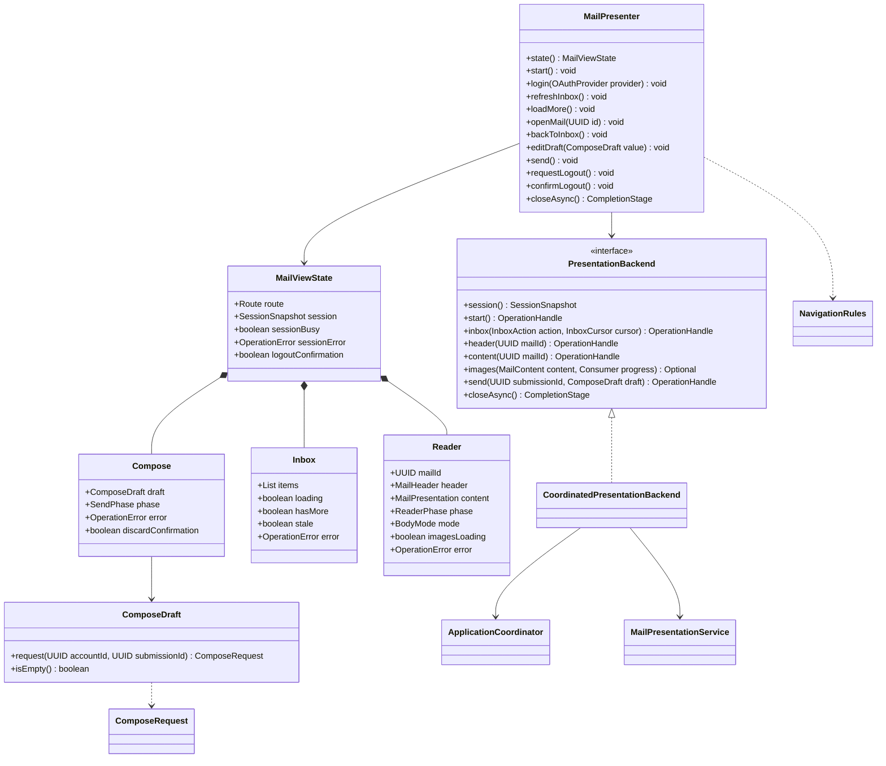

# Presentación y estado de las pantallas

Referencia de la implementación revisada el 17 de octubre de 2026. Se muestran responsabilidades y contratos seleccionados; no todos los miembros privados ni las sobrecargas. Las clases externas al paquete se incluyen solo para explicar dependencias.

`Inbox`, `Reader` y `Compose` son records anidados de `MailViewState`, no paquetes ni pantallas adicionales. El presentador recibe acciones y publica instantáneas inmutables; `MailWindow` las convierte en controles. Esta separación permite probar navegación, cancelación y respuestas tardías sin iniciar JavaFX.

El presentador mantiene slots SESSION, INBOX, READER, IMAGES y SEND. Comprueba tanto el número de solicitud como la versión de sesión antes de aplicar un resultado. Así, una descarga del correo A no sustituye al correo B que se abrió después. Los callbacks se despachan con `Platform.runLater` en la integración real.

El adaptador prepara el cuerpo con `prepareWithoutImages`, marca visto **localmente** y libera la prioridad del lector. Después solicita imágenes en el trabajador de presentación y entrega avances. Un fallo de imágenes conserva el cuerpo y el modo texto elegido. `imagesLoading` permite distinguir espera y error.

`ComposeDraft` contiene Para, CC, CCO, asunto y texto; el remitente procede de la cuenta activa. `ComposeRequest` añade los identificadores de cuenta y envío. El estado UNKNOWN bloquea la repetición automática; el usuario debe tratarlo como incierto.

Fuente: [paquete presentation](../../../src/main/java/com/juanpablo/evermail/presentation). Véanse [navegación](uml-navigation.md), [lectura](../lectura-y-cache.md) y [envío](../envio-y-recuperacion.md).
