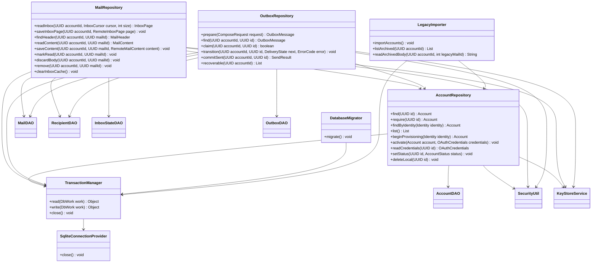

# Repositorios, cifrado y transacciones

Referencia de la implementación revisada el 17 de octubre de 2026. Se muestran responsabilidades y contratos seleccionados; no todos los miembros privados ni las sobrecargas. Las clases externas al paquete se incluyen solo para explicar dependencias.

## Responsabilidades y motivos

Los repositorios enlazan cuenta, objetos Java, cifrado y SQL. `AccountRepository.require` rechaza cuentas inexistentes o no utilizables. `readContent` devuelve `null` cuando existe el encabezado pero falta el cuerpo; una fila ausente produce `MAIL_NOT_FOUND`. Esta distinción permite descargar contenido sin confundirlo con un correo eliminado.

`TransactionManager` serializa una conexión. `write` confirma o revierte el bloque completo; `read` también serializa el acceso, pero su nombre no impone que JDBC sea de solo lectura. `DbWork` y `Object` abrevian la función y su retorno genérico. El proveedor abre la conexión en su constructor, no mediante un método público `open`.

`saveInboxPage` reconcilia el intervalo confirmado por IMAP y su `UIDVALIDITY`; no declara completos los huecos que no inspeccionó. Los cuerpos y vistos locales existentes se conservan al actualizar encabezados. `discardBody` retira solo contenido; `remove` retira el mensaje INBOX local. `clearInboxCache` elimina toda la bandeja local y `inbox_state`, y después ejecuta `VACUUM` fuera de la transacción. Conserva cuentas, claves, SENT y outbox.

`OutboxRepository.prepare` comprueba que un `submissionId` repetido tenga el mismo contenido. `claim` compara PENDING con SENDING en SQL. `commitSent` registra SENT y RECORDED juntos, recifrando previamente para el identificador del correo. `recoverable` devuelve filas de `OutboxDAO`, no mensajes descifrados. Véase [envío y recuperación](../envio-y-recuperacion.md).

`DatabaseMigrator` mantiene el esquema en versión 2. `LegacyImporter` conserva acceso a archivos de correo antiguos en tablas `legacy_*`; no inventa UID para introducirlos en la bandeja actual. Véase [persistencia y seguridad](../persistencia-y-seguridad.md).

Fuente: [paquete repository](../../../src/main/java/com/juanpablo/evermail/repository).
