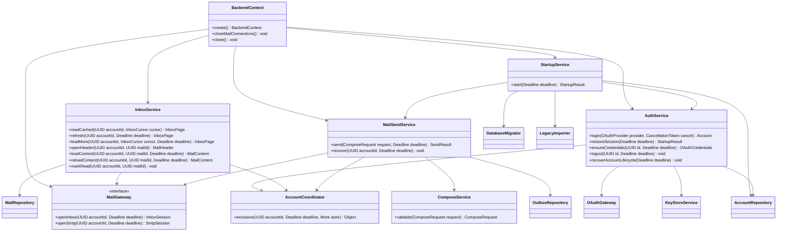
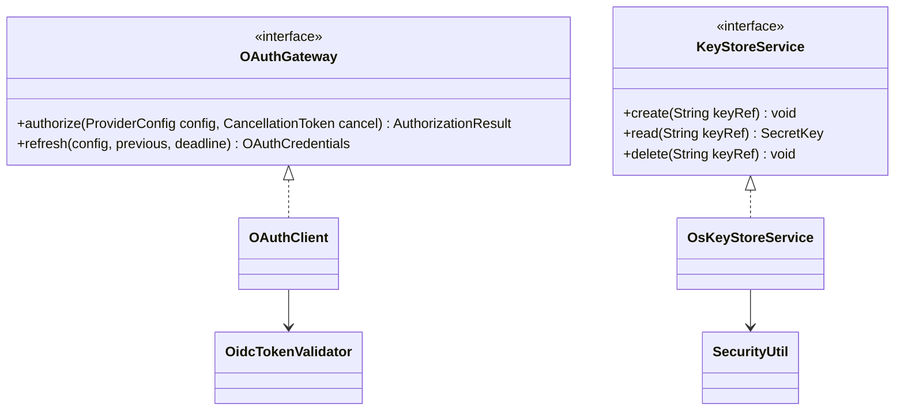
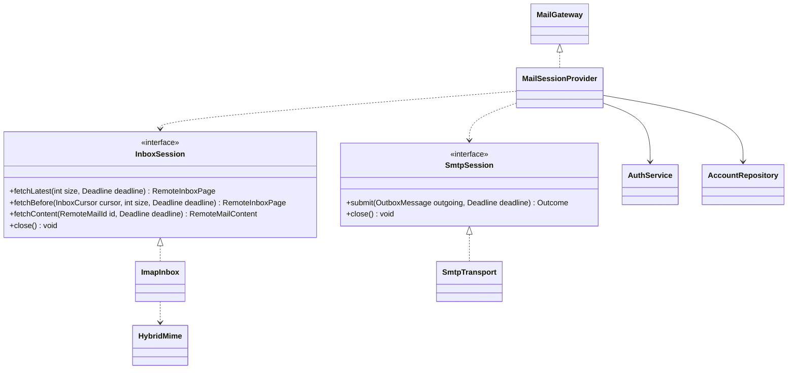
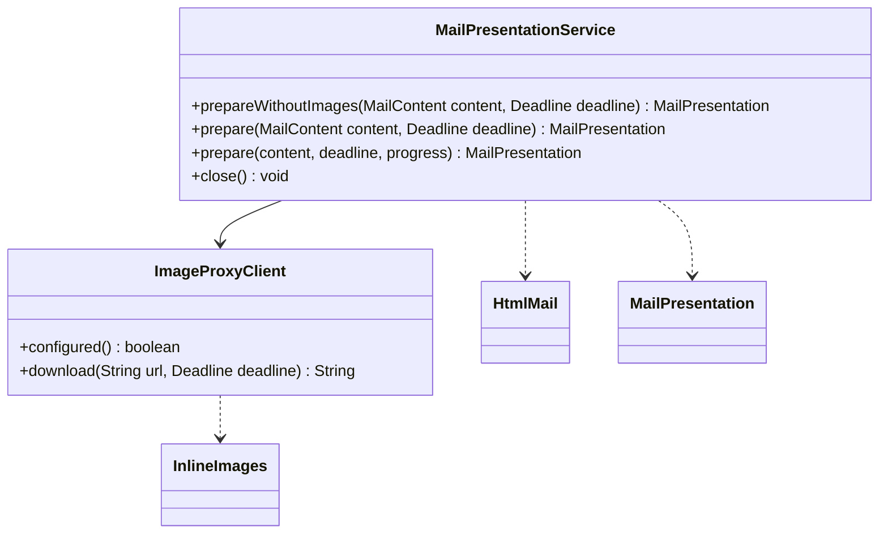
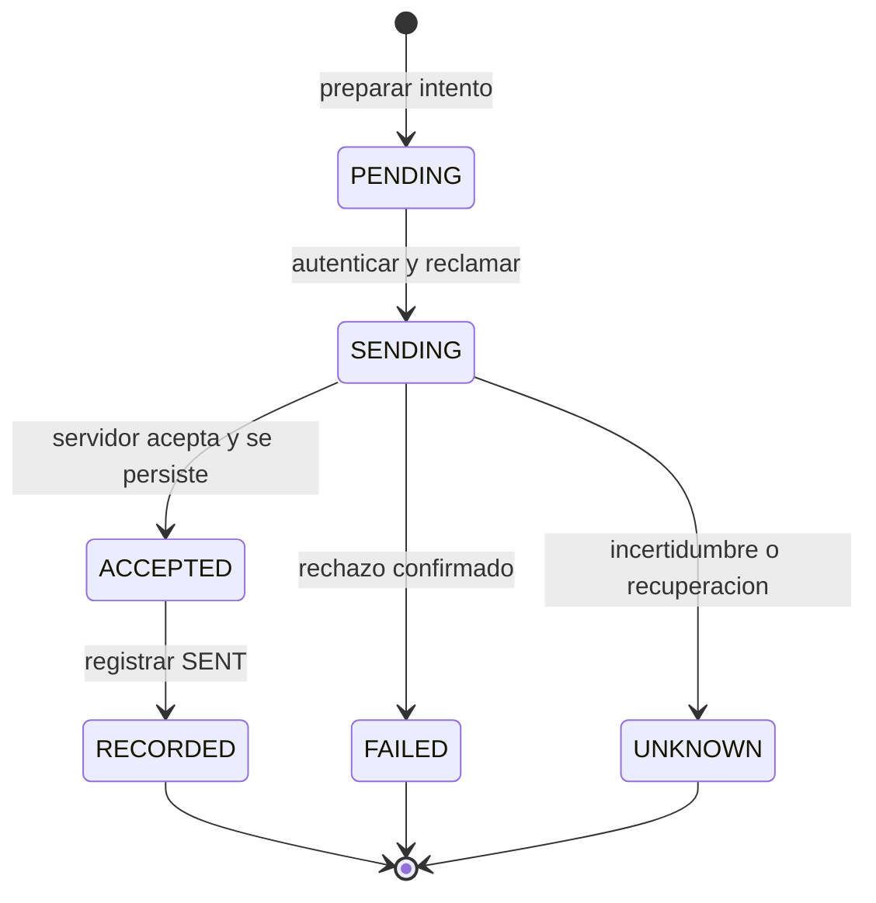

# Servicios y adaptadores de infraestructura

Referencia de la implementación revisada el 17 de octubre de 2026. Se muestran responsabilidades y contratos seleccionados; no todos los miembros privados ni las sobrecargas. Las clases externas al paquete se incluyen solo para explicar dependencias.

## Por qué se separan estas piezas

Los servicios coordinan casos de uso; los repositorios deciden cómo persistirlos. Las interfaces `MailGateway` y `OAuthGateway` permiten sustituir red por transportes simulados en pruebas. `BackendContext` construye los colaboradores compartidos y se ocupa de cerrar transporte, SQLite y almacén de claves.

`AccountCoordinator.exclusive` mantiene un bloqueo por cuenta durante toda la operación suministrada, incluida la red cuando el servicio la realiza dentro del bloque. No es un planificador de prioridad. `ApplicationCoordinator`, descrito aparte, organiza el trabajo de la sesión y la precarga. Esta distinción explica por qué añadir hilos no garantiza que una apertura adelante a una descarga activa.

## Autenticación y claves

OAuth obtiene autorización y una identidad validada. El almacén del sistema conserva las claves usadas para cifrar datos locales; esos dos tipos de credencial tienen ciclos de vida diferentes. Véase [persistencia y seguridad](../persistencia-y-seguridad.md).

## Transporte de correo

`ImapInbox` y `SmtpTransport` son clases anidadas de `MailSessionProvider`. `Outcome` pertenece a `SmtpSession` y distingue ACCEPTED, REJECTED y UNKNOWN. La conexión IMAP se presta exclusivamente y se conserva hasta 30 s de inactividad; sus temporizadores llevan generación para evitar cierres de un préstamo posterior. SMTP usa STARTTLS y OAuth; IMAP usa TLS, READ_ONLY y PEEK.

## Preparación del correo

`MailPresentationService` prepara un primer cuerpo sin imágenes externas y después resuelve recursos por un grupo reutilizable de tres trabajadores. Publica avances por finalización; `ImageProxyClient` es el único descargador de imágenes externas del mensaje. No existe precarga persistente de esas imágenes.

## Estados duraderos del envío

La aceptación significa que el servidor SMTP aceptó el envío, no que llegó a la bandeja del destinatario. Si falla la persistencia tras SMTP, la fila puede quedar SENDING aunque el resultado devuelto sea UNKNOWN. El diagrama muestra estados guardados; [envío y recuperación](../envio-y-recuperacion.md) explica esa diferencia y los reintentos.

Fuente: [paquete service](../../../src/main/java/com/juanpablo/evermail/service).
