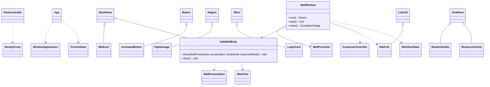

# Componentes de interfaz JavaFX

Referencia de la implementación revisada el 17 de octubre de 2026. Se muestran responsabilidades y contratos seleccionados; no todos los miembros privados ni las sobrecargas. Las clases externas al paquete se incluyen solo para explicar dependencias.

## Responsabilidad de cada grupo

| Grupo                                         | Función y motivo                                                                                                    |
| --------------------------------------------- | ------------------------------------------------------------------------------------------------------------------- |
| MailWindow                                    | Carga vistas, conecta acciones, representa estado y coordina el cierre; mantiene la lógica de sesión fuera de FXML. |
| SafeMailBody                                  | Alterna HTML/texto y aplica actualizaciones al DOM saneado sin recargar todo el documento por cada imagen.          |
| ComposeController                             | Revela y restablece CC/CCO; no autentica ni envía correo.                                                           |
| ViewController, ResponsiveGrid, ReaderDetails | Ajustan tipografía y distribución al espacio disponible.                                                            |
| MailCell                                      | Representa una fila de correo y su selección.                                                                       |
| AnimatedButton                                | Anima interacción; admite reducir movimiento.                                                                       |
| FigmaImage, MailIcon, LoginCard, DesignFonts  | Conservan recursos, proporciones, estilo de acceso y fuentes del diseño.                                            |
| WindowAppearance                              | Integra apariencia de la ventana con Windows.                                                                       |
| PreviewData                                   | Proporciona datos ficticios para revisar composiciones sin cuentas.                                                 |

`MailCell` especializa `ListCell<MailHeader>`; se abrevia el genérico en el dibujo. Los FXML instancian los controles de diseño, por lo que no todas las conexiones visuales son campos Java de `MailWindow`.

El visor mantiene JavaScript deshabilitado, bloquea recursos remotos y entrega los clics de enlaces al manejador externo. Las actualizaciones pertenecen al correo y sesión vigentes; la interfaz no descarga MIME ni descifra SQLite. El cuerpo saneado llega desde el backend.

Los FXML y CSS anteriores se conservan: [recursos](../../../src/main/resources/com/juanpablo/evermail). Para probar composiciones: [previsualización](../../desarrollo/previsualizar-interfaz.md). Fuente: [paquete ui](../../../src/main/java/com/juanpablo/evermail/ui).
