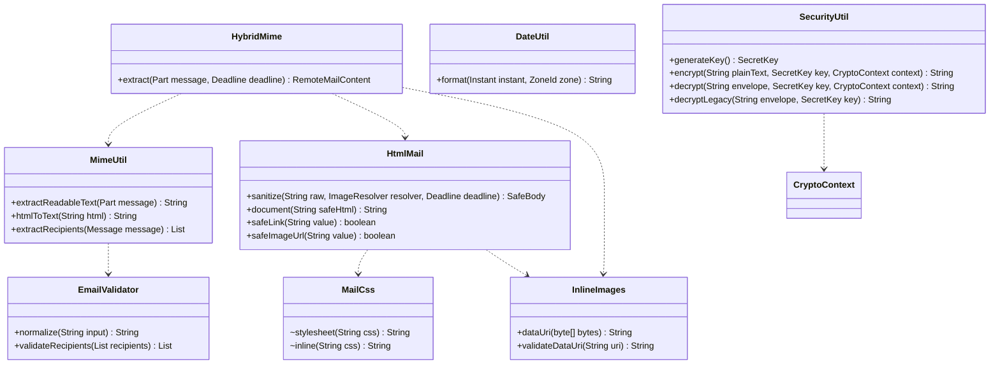

# Utilidades de MIME, HTML, CSS y cifrado

Referencia de la implementación revisada el 17 de octubre de 2026. Se muestran responsabilidades y contratos seleccionados; no todos los miembros privados ni las sobrecargas. Las clases externas al paquete se incluyen solo para explicar dependencias.

`HybridMime` recorre MIME con límites de tamaño, profundidad y número de partes. Conserva texto y HTML alternativos y resuelve imágenes CID referenciadas; no ofrece una descarga general de adjuntos. `MimeUtil` extrae texto y destinatarios; los encabezados remotos los construye el transporte IMAP.

`HtmlMail` reconstruye HTML permitido con jsoup. `MailCss`, de visibilidad de paquete, analiza CSS con ph-css y filtra propiedades, selectores y media queries. Así conserva parte del diseño de los correos sin permitir código activo ni hojas externas. `SafeBody` e `ImageResolver` son tipos anidados en `HtmlMail`; hay una sobrecarga de `sanitize` para resolver recursos remotos.

Las imágenes y fondos externos quedan como referencias inertes hasta que `ImageProxyClient` devuelve datos raster validados. `InlineImages` verifica formatos y dimensiones. El visor no recibe una URL de origen que pueda descargar por su cuenta. Véase [lectura y caché](../lectura-y-cache.md).

`EmailValidator` normaliza dominio y espacios, conserva el local-part y valida duplicados por rol. No aplica reglas privadas de Gmail a todas las direcciones. `DateUtil` adapta instantes a la zona de presentación.

`SecurityUtil` cifra con AES-GCM y autentica cuenta, registro y campo con `CryptoContext`; la explicación y sus límites están en [persistencia y seguridad](../persistencia-y-seguridad.md). Los adaptadores de red y claves se muestran en [servicios](uml-service.md), no se redefinen aquí.

Fuente: [paquete util](../../../src/main/java/com/juanpablo/evermail/util).
