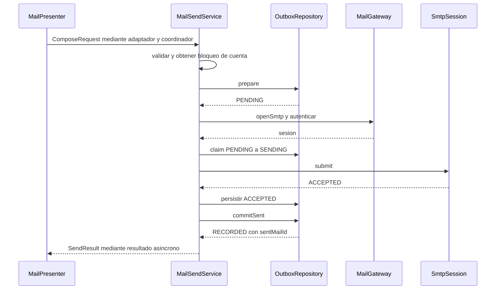

# Envío, idempotencia y resultados inciertos

SMTP y SQLite no comparten una transacción. El servidor puede aceptar un correo y la aplicación perder la conexión o fallar antes de guardar esa confirmación. Ese intervalo explica la mayor parte de la complejidad del envío.

## Qué representa un intento

`ComposeDraft` es el formulario editable. `ComposeRequest` incorpora cuenta y `submissionId`. `OutboxRepository.prepare` normaliza destinatarios y guarda un intento PENDING con cuerpo cifrado antes de transmitirlo.

Si vuelve a recibir el mismo identificador y contenido, reutiliza el intento. Si el contenido cambió, devuelve IDEMPOTENCY_CONFLICT. Esto es idempotencia local: no constituye una garantía de que cualquier servidor SMTP elimine duplicados por Message-ID.

## Recorrido normal

La conexión y autenticación ocurren **antes de claim**. Un fallo anterior a transmitir deja PENDING y permite reintentar conscientemente el mismo intento. Después de claim, una excepción de transmisión se considera conservadoramente UNKNOWN.

## Estados y acciones seguras

| Estado   | Significado                                                | Recuperación                                          |
| -------- | ---------------------------------------------------------- | ----------------------------------------------------- |
| PENDING  | Intento preparado, todavía no reclamado para transmitir    | No se envía automáticamente al arrancar.              |
| SENDING  | Hay una transmisión reclamada cuyo resultado aún no consta | Tras reinicio se transforma en UNKNOWN.               |
| ACCEPTED | Se persistió que SMTP aceptó el mensaje                    | Se puede terminar el registro local sin repetir SMTP. |
| RECORDED | SENT y el estado del intento se confirmaron juntos         | Repetir el registro devuelve el mismo resultado.      |
| FAILED   | Rechazo confirmado sin entrega                             | Un nuevo intento requiere una acción explícita.       |
| UNKNOWN  | No hay certeza suficiente sobre el resultado               | No se reenvía automáticamente.                        |

El [diagrama de estados](diagramas/uml-service.md#estados-duraderos-del-envío) es la referencia visual de estas transiciones. ACCEPTED no significa leído por el destinatario ni siquiera llegada garantizada a su bandeja; significa aceptación del servidor SMTP.

## Dos fallos locales distintos

1. **SMTP acepta, pero falla guardar ACCEPTED.** La fila puede seguir SENDING. El servicio devuelve UNKNOWN con LOCAL_SAVE_PENDING. Al reiniciar, SENDING se recupera como UNKNOWN; repetir SMTP podría duplicar el correo.
2. **ACCEPTED se guarda, pero falla `commitSent`.** El servicio devuelve ACCEPTED con LOCAL_SAVE_PENDING. El arranque puede completar SENT y RECORDED sin enviar otra vez.

`commitSent` genera un identificador estable para SENT y recifra el cuerpo con el contexto de ese nuevo registro. Dentro de una transacción inserta el correo, sus destinatarios y cambia ACCEPTED a RECORDED. Si falla, revierte ese conjunto.

## Qué ve el usuario

Durante SENDING el formulario se bloquea. UNKNOWN o ACCEPTED con guardado pendiente conservan el texto y evitan un reenvío automático. Una operación asíncrona puede terminar sin excepción y aun así devolver UNKNOWN: la interfaz debe interpretar `SendResult`, no únicamente la finalización del futuro.

Cancelar o cerrar una ventana no puede deshacer un correo que ya llegó al servidor. Por eso el cierre espera a que el trabajador deje de usar recursos y el intento conserva un estado recuperable.

El mensaje saliente es texto plano UTF-8. CCO se incorpora al sobre de destinatarios, pero no a las cabeceras transmitidas. El presupuesto configurado actual es 60 s; es un límite de operación, no una promesa de entrega en ese tiempo.

Fuentes: [MailSendService](../../src/main/java/com/juanpablo/evermail/service/MailSendService.java), [OutboxRepository](../../src/main/java/com/juanpablo/evermail/repository/OutboxRepository.java), [MailSessionProvider](../../src/main/java/com/juanpablo/evermail/service/MailSessionProvider.java). Pruebas: [servicios](../../src/test/java/com/juanpablo/evermail/service) y [repositorios](../../src/test/java/com/juanpablo/evermail/repository).
