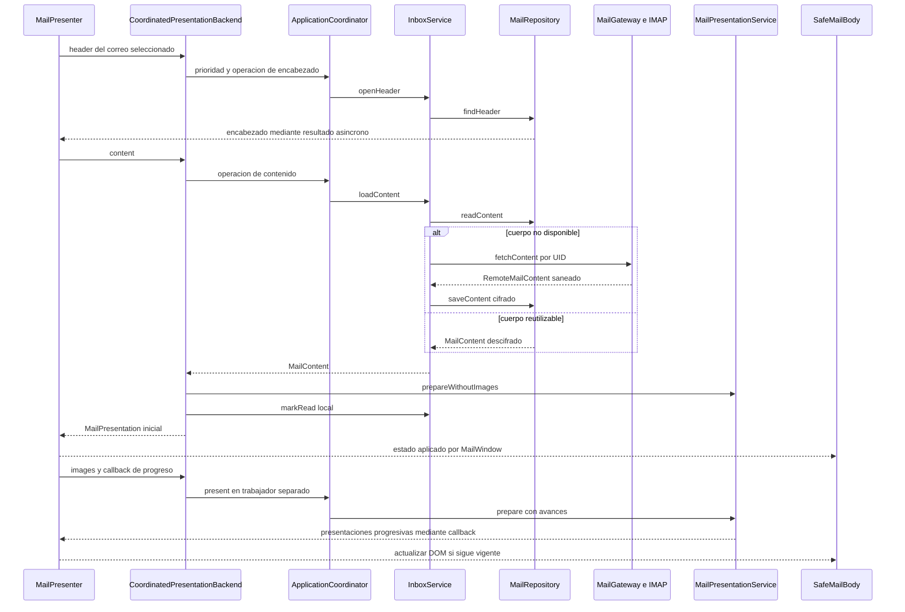

# De IMAP a un correo visible

Un correo tiene tres representaciones distintas: MIME remoto, contenido local cifrado y presentación segura. Separarlas permite reutilizar un cuerpo descargado sin tratar el HTML del remitente como una página web de confianza.

## Apertura solicitada por el usuario

El esquema abrevia la vuelta de los resultados a través de los futuros; el repositorio no llama directamente al presentador. El marcado local ocurre después de preparar el primer contenido y antes de devolverlo: no confirma que el usuario lo haya leído ni cambia `SEEN` en el proveedor.

Un cuerpo antiguo puede requerir recuperar referencias de imágenes. `InboxService` intenta una actualización acotada y conserva la copia legible si falla; MAIL_NOT_FOUND y cancelación tienen tratamiento específico. El caso normal con caché válida evita otra descarga MIME.

## MIME: por qué un correo no es un único texto

`multipart/alternative` puede contener texto y HTML del mismo mensaje: mostrarlos concatenados duplicaría el contenido. `multipart/related` añade recursos ligados por Content-ID; una imagen CID se resuelve solo si el cuerpo la referencia. Los adjuntos ordinarios se omiten.

`HybridMime` limita partes, profundidad y bytes antes de construir `RemoteMailContent`. `HtmlMail` reconstruye etiquetas permitidas, y `MailCss` analiza y filtra CSS. El objetivo es conservar formato útil, no reproducir cualquier página web ni garantizar identidad visual con Gmail.

Las imágenes raster se validan por formato, tamaño y dimensiones. JavaScript, iframes, formularios y hojas externas no se habilitan. Los enlaces se entregan al manejador externo tras una acción del usuario.

## Imágenes externas y actualización progresiva

La primera preparación no espera imágenes externas. Después `MailPresentationService` recoge hasta 24 URLs deduplicadas y usa tres trabajadores compartidos de su instancia. Los resultados se procesan por finalización y se publican en grupos de hasta tres o tras 150 ms de espera, dentro de los límites de memoria y tiempo.

`ImageProxyClient` obtiene datos a través del proxy configurado. El HTML entregado al WebView no conserva URLs de origen activas: las referencias pendientes son inertes y los recursos válidos llegan como datos. `MailPresentation.DisplayNode` transporta una instantánea saneada; `SafeMailBody` actualiza el DOM sin ejecutar JavaScript ni recargar toda la página por imagen.

Un error de imagen no obliga a perder el cuerpo. Cambiar de correo o sesión invalida avances anteriores; elegir texto no debe provocar que una imagen tardía vuelva a activar HTML. Las imágenes externas no tienen caché persistente ni precarga automática antes de abrir el correo. Las imágenes CID admitidas sí pueden formar parte del cuerpo cifrado.

## Precarga, paginación y límites

Después de REFRESH o MORE, el coordinador recibe encabezados y precarga cuerpos uno a uno. Utiliza `loadContent`, sin llamar al adaptador que marca visto. Una apertura tiene prioridad entre cuerpos, pero puede esperar la descarga activa y aprovechar después su resultado guardado.

La página es de hasta 50 encabezados. `InboxCursor` usa cuenta, UIDVALIDITY y UID anterior, en vez de OFFSET: recibir mensajes nuevos no desplaza las páginas antiguas. `inbox_state` registra intervalos confirmados, incluidos huecos por mensajes eliminados. Un cambio de UIDVALIDITY invalida la bandeja local de esa generación, no los enviados.

`InboxService` retiene hasta 100 cuerpos en su registro de uso y retira los menos recientes conservando encabezados. Este límite de cantidad **no implementa un presupuesto físico de 2 GB**. Al cerrar se limpia la bandeja completa; no se conservan 50 mensajes entre ejecuciones.

La conexión IMAP se reutiliza con préstamo exclusivo, temporizador por generación y vencimiento de 30 s sin uso. PEEK y READ_ONLY evitan marcar leído en el proveedor. Se descarta ante fallo, cambio de credencial o cierre.

## Cómo interpretar una medida

Conexión, descarga MIME, primer cuerpo preparado y últimas imágenes son etapas diferentes. `ReadTimings` mide backend; no incluye aplicación del DOM ni pintura JavaFX. Una reapertura puede ahorrar IMAP, pero volver a pedir imágenes externas. No debe sumarse una subetapa a un total que ya la contiene.

Fuentes: [InboxService](../../src/main/java/com/juanpablo/evermail/service/InboxService.java), [MailPresentationService](../../src/main/java/com/juanpablo/evermail/service/MailPresentationService.java), [SafeMailBody](../../src/main/java/com/juanpablo/evermail/ui/SafeMailBody.java). Uso práctico: [descarga y limpieza](../desarrollo/descarga-y-limpieza.md), [proxy](../desarrollo/proxy-imagenes.md) y [tiempos](../pruebas/tiempos-lectura.md).
