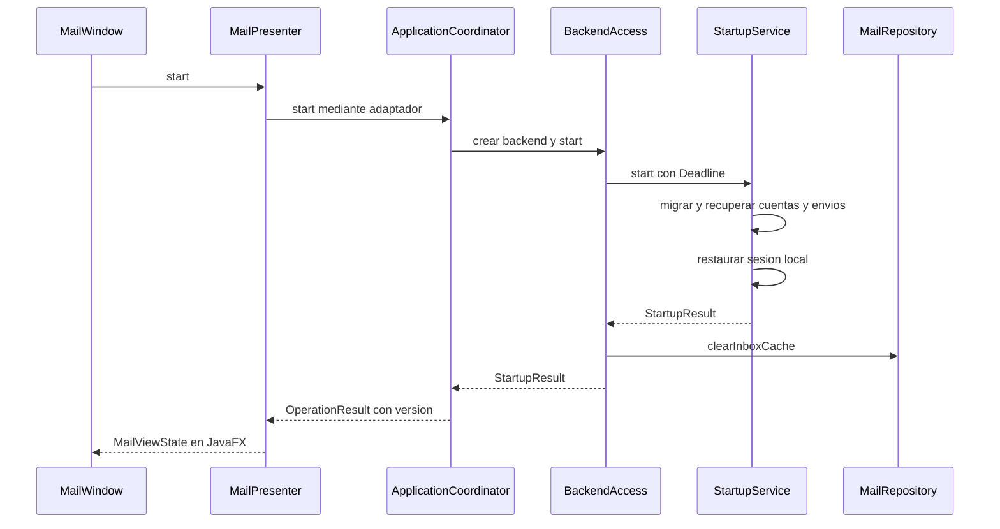

# Sesión, concurrencia y cierre

La pregunta central es: **¿cómo puede la ventana seguir respondiendo mientras hay red, sin mostrar resultados de una cuenta o un correo anterior?** Evermail separa ejecución y representación, y añade una versión a la sesión.

## Desde el arranque hasta la bandeja

La restauración de una cuenta ACTIVE comprueba credenciales y clave locales. En el código revisado, no renueva el token por red durante `restoreSession`; esa renovación se hace cuando un transporte necesita credenciales. Por eso READY no demuestra conectividad ni permisos IMAP/SMTP válidos en ese instante.

El arranque limpia INBOX aunque hubiera restos de una ejecución anterior. Una cuenta que necesita reautorización puede conservar sus credenciales y claves, pero no debe esperarse que su antigua bandeja sobreviva a este arranque. Durante una misma ejecución sí puede quedar contenido legible tras perder conectividad.

## Quién ejecuta qué

| Ejecutor o coordinación                | Trabajo                                                                    |
| -------------------------------------- | -------------------------------------------------------------------------- |
| Hilo JavaFX                            | Eventos y aplicación de `MailViewState`; no debe esperar un futuro de red. |
| Trabajador de cuenta del coordinador   | Arranque, autenticación, bandeja, cuerpos, envío y precarga secuencial.    |
| Trabajador de presentación             | Orquesta la fase posterior de imágenes sin ocupar al trabajador de cuenta. |
| Grupo de tres trabajadores de imágenes | Descargas por proxy con cola acotada.                                      |
| AccountCoordinator                     | Bloqueo por cuenta dentro de los servicios; no es otro trabajador.         |
| TransactionManager                     | Acceso serializado a la conexión SQLite; no es un pool de conexiones.      |

También existen temporizadores e hilos de bibliotecas y de JavaFX; la tabla no es un recuento total del proceso.

La cola normal admite por defecto 32 operaciones pendientes y reserva una plaza para una transición. La precarga mantiene hasta 100 identificadores aparte y solo inicia el siguiente cuando no hay trabajo de cuenta pendiente ni un lector prioritario. Una descarga que ya empezó puede retrasar una apertura. La prioridad se aplica **entre operaciones**, no garantiza interrumpir la red activa.

## Por qué no basta con cancelar

Imagina que abres A y luego B. Aunque se solicite cancelar A, una biblioteca podría terminar más tarde y dejar un callback en la cola visual. Aplicar ese callback sin comprobar su procedencia sustituiría B por A.

El coordinador captura la versión de sesión en `OperationHandle`. El presentador también mantiene la identidad de solicitud de cada slot. Al despachar el resultado vuelve a comprobar ambas cosas. Una transición de sesión invalida las operaciones anteriores; cambiar de correo invalida READER e IMAGES. La cancelación ahorra trabajo cuando es posible, mientras que la comprobación de identidad protege la pantalla ante respuestas tardías.

Los plazos de operaciones ordinarias nacen al entrar al trabajador. No incluyen espera en cola, y no garantizan que una llamada externa se interrumpa instantáneamente. Las cifras actuales están centralizadas en [configuración](diagramas/uml-config.md).

## Cerrar ventana no es cerrar sesión

| Acción                                | Datos que se retiran                                                       | Datos que permanecen                                |
| ------------------------------------- | -------------------------------------------------------------------------- | --------------------------------------------------- |
| Retirar un cuerpo por límite de caché | Cuerpo de ese INBOX                                                        | Encabezado y visto local                            |
| Cerrar ventana                        | INBOX, destinatarios asociados, vistos e `inbox_state`; se compacta SQLite | Cuenta, credenciales, claves, SENT y outbox         |
| Cerrar sesión de una cuenta           | Datos locales de esa cuenta y sus claves                                   | Los correos originales del proveedor no se eliminan |

`closeAsync` invalida la sesión, solicita cancelación y espera que los trabajadores dejen de usar recursos. Después `BackendAccess.close` limpia la bandeja y cierra el contexto. La ventana espera asíncronamente y comunica fallos: CLOSED es una fase del estado, no una confirmación de limpieza completada.

Logout marca la cuenta DISCONNECTING, elimina claves y después datos locales bajo coordinación. Si queda incompleto, el siguiente arranque recupera el ciclo de cuenta. No equivale a revocar permisos OAuth en Google o Microsoft.

## Dónde estudiar el código y las pruebas

- [ApplicationCoordinator](../../src/main/java/com/juanpablo/evermail/application/ApplicationCoordinator.java): planificación, versión y cancelación.
- [BackendAccess](../../src/main/java/com/juanpablo/evermail/application/BackendAccess.java): limpieza ligada a la ventana.
- [MailPresenter](../../src/main/java/com/juanpablo/evermail/presentation/MailPresenter.java): aceptación de respuestas y estado visual.
- [Pruebas de application](../../src/test/java/com/juanpablo/evermail/application) y [presentation](../../src/test/java/com/juanpablo/evermail/presentation): colas, sesión y respuestas tardías con dobles controlados.
