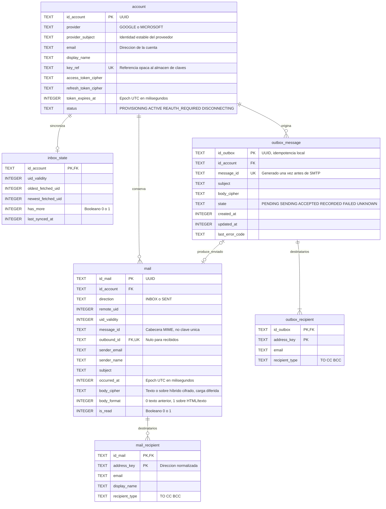

# Modelo entidad-relación de SQLite

Referencia revisada el 17 de octubre de 2026 frente a `schema.sql` y `DatabaseMigrator`. Representa las seis tablas del esquema activo, versión 2; las tablas `legacy_*` conservadas durante una migración no se mezclan con este modelo.

## Qué representa cada tabla

| Tabla            | Responsabilidad                                                                    |
| ---------------- | ---------------------------------------------------------------------------------- |
| account          | Identidad local, estado y tokens cifrados; `key_ref` referencia una clave externa. |
| inbox_state      | Intervalo de UID que se ha inspeccionado y si quedan páginas remotas.              |
| mail             | Encabezados INBOX o SENT y cuerpo cifrado opcional.                                |
| mail_recipient   | Destinatarios del correo local, incluido nombre cuando está disponible.            |
| outbox_message   | Intento de envío y estado duradero para evitar repeticiones inseguras.             |
| outbox_recipient | Destinatarios del intento; esta tabla no almacena `display_name`.                  |

## Restricciones físicas y reglas de aplicación

- PK identifica una fila, FK referencia otra y UK señala una clave única. Las PK dobles de destinatarios son compuestas: identificador del correo/intento y `address_key`.
- `account` tiene UNIQUE(provider, provider_subject). La identidad validada se basa en emisor y sujeto, no en el correo mutable. ACTIVE exige tokens y expiración no nulos; los estados de alta o desconexión permiten su ausencia.
- `mail.sender_email` admite NULL en SQL, igual que `sender_name`, `message_id` y `body_cipher`. El asunto y la fecha son obligatorios. `body_cipher=NULL` significa que no hay cuerpo disponible, no un mensaje vacío.
- El CHECK de `mail` distingue INBOX de SENT. Los repositorios y el transporte verifican identidades remotas positivas. **SQLite acepta un CHECK cuyo resultado sea NULL**: el esquema no declara `remote_uid` y `uid_validity` como NOT NULL, así que el CHECK por sí solo no prueba esa positividad frente a cualquier inserción SQL externa.
- El índice parcial único de INBOX es `(id_account, uid_validity, remote_uid)`. `outbound_id` es único para vincular cada intento con como máximo un SENT. La pertenencia a la misma cuenta y el registro de la dirección SENT se controlan en el repositorio; no hay una FK compuesta que lo imponga por sí sola.
- El dibujo expresa que un intento listo tiene destinatarios. Esa condición se valida al preparar el envío; una FK no garantiza por sí misma que el padre tenga al menos un hijo.
- Los booleanos y enumeraciones tienen CHECK. Las FK de cuenta y destinatarios usan CASCADE; `mail.outbound_id` usa RESTRICT. Por eso la eliminación completa de una cuenta retira primero correos que referencian outbox.
- `inbox_state` puede no existir antes de cargar la bandeja. Sus límites y fecha admiten NULL en el esquema; la ruta normal guarda valores completos al confirmar una página.
- Las fechas son epoch UTC en milisegundos. La bandeja se ordena por UID; el transporte toma fecha recibida y, si falta, la hora actual. SENT toma la fecha registrada de aceptación.

## Cuerpos, caché y migraciones

`body_format=0` conserva texto cifrado; `body_format=1` guarda un sobre JSON cifrado con texto, HTML, indicador de imágenes y `imageReferencesVersion`. Esta última versión va dentro del sobre, no es otra columna. La migración 1→2 añade `body_format` sin reescribir cuerpos existentes.

El esquema no cifra toda SQLite. Tokens y cuerpos están cifrados; asuntos, direcciones, fechas y otros metadatos permanecen legibles. Los detalles están en [persistencia y seguridad](../../arquitectura/persistencia-y-seguridad.md).

Al cerrar la ventana se elimina INBOX, sus destinatarios y `inbox_state`; se conservan cuenta, claves, SENT y outbox. El arranque repite la limpieza para recuperar cierres forzados. Por tanto, la caché de bandeja no es un archivo de correo entre ejecuciones. El presupuesto físico total de 2 GB sigue pendiente.

La migración de bases antiguas renombra tablas a `legacy_*` y preserva datos. `LegacyImporter` importa cuentas y ofrece lectura de encabezados/cuerpos archivados sin inventar UID remotos. No es una incorporación automática de todo el correo antiguo a INBOX.

Fuentes: [schema.sql](../../../src/main/resources/db/schema.sql), [DatabaseMigrator](../../../src/main/java/com/juanpablo/evermail/repository/DatabaseMigrator.java), [repositorios](../../arquitectura/diagramas/uml-repositories.md).
