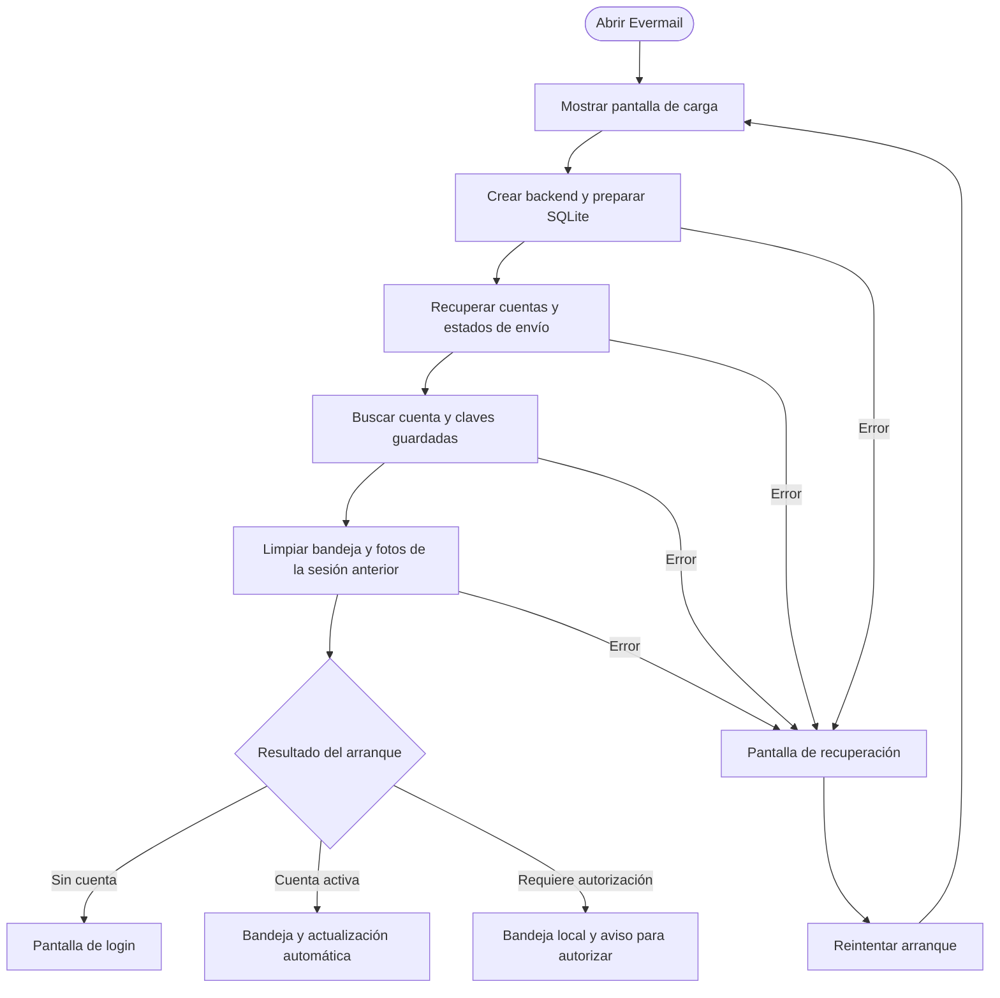
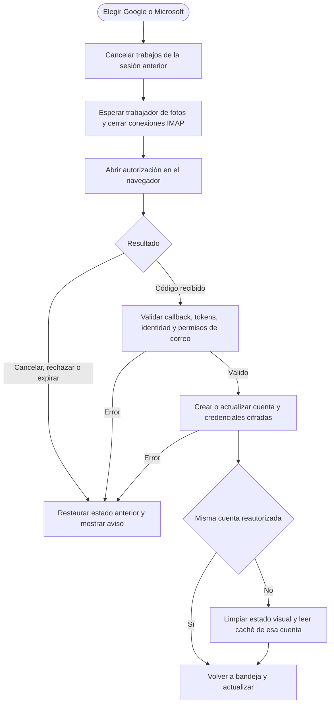
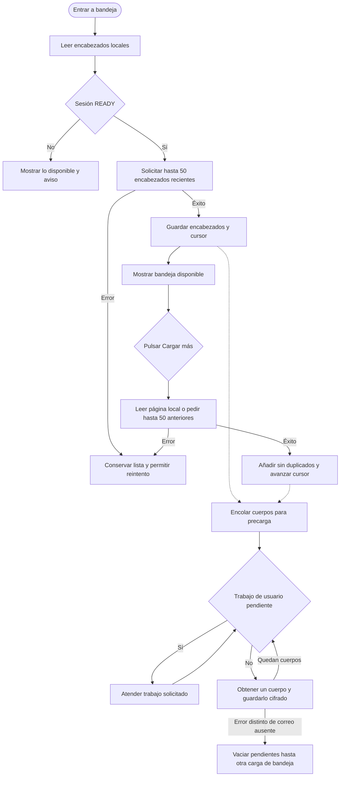
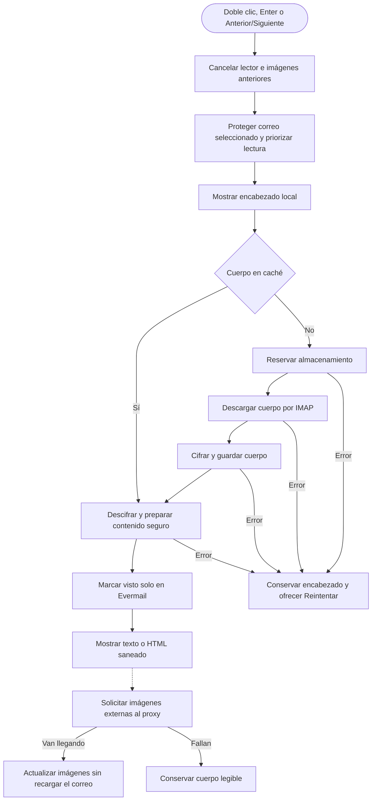
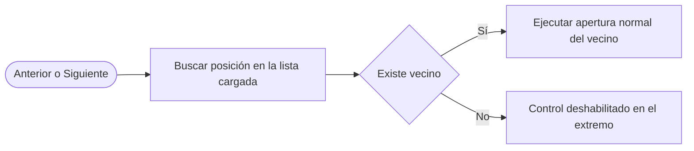
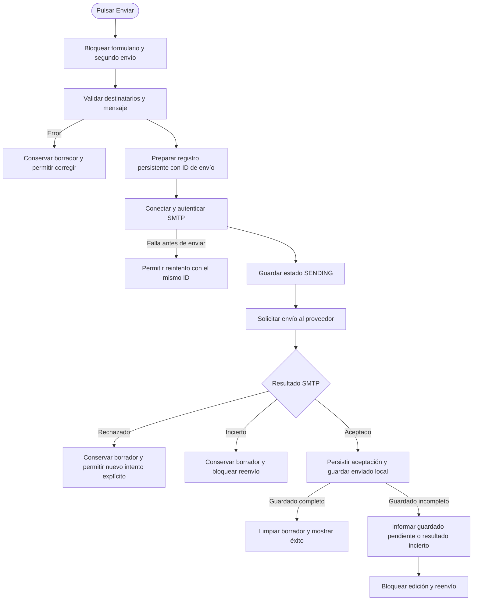
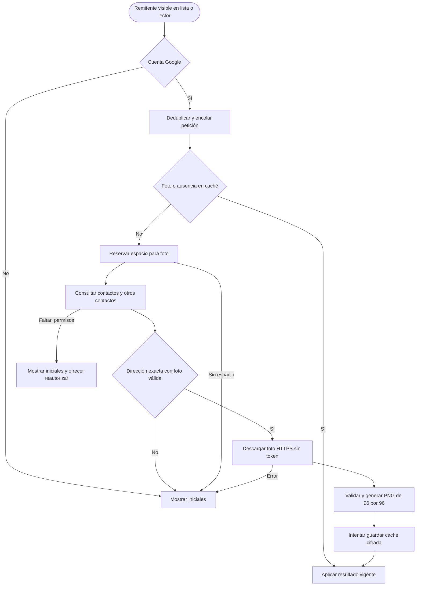
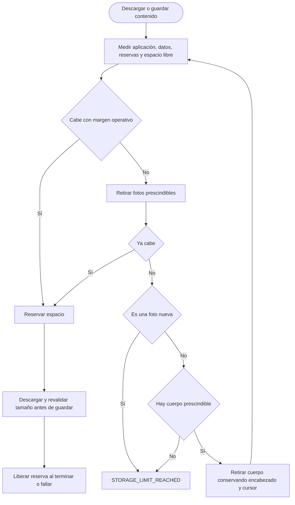
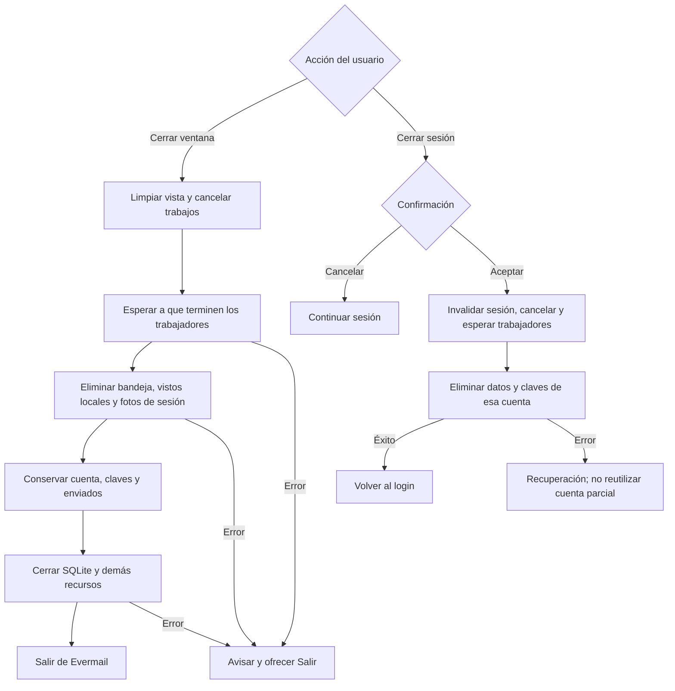

# Flujos actuales de Evermail

Revisión del 8 de noviembre de 2026, basada en el código local, incluidos los cambios aún no confirmados en Git. Estos diagramas describen el recorrido normal iniciado por `App`, no los modos de demostración ni propuestas para versiones futuras.

Las flechas continuas muestran pasos o decisiones; las discontinuas indican trabajo de fondo. Los errores se simplifican por categoría. Una operación terminada se publica en JavaFX solo si sigue correspondiendo a la sesión y solicitud vigentes.

## 1. Arranque y elección de pantalla

La restauración de una cuenta activa es local: no comprueba conexión al proveedor ni renueva el token en ese momento. El primer acceso a IMAP o SMTP comprueba las credenciales y las renueva si hace falta. Por tanto, `READY` no demuestra que Internet o el proveedor estén disponibles.

La limpieza inicial recupera restos de cierres forzados. Conserva cuenta, claves, enviados y registros de envío. Como también elimina la bandeja al arrancar, no existe una bandeja persistente para leer correos de la ejecución anterior sin conexión. Esto cumple la política vigente de caché por sesión.

Fuentes: [App](../../src/main/java/com/juanpablo/evermail/App.java), [StartupService](../../src/main/java/com/juanpablo/evermail/service/StartupService.java), [AuthService](../../src/main/java/com/juanpablo/evermail/service/AuthService.java), [BackendAccess](../../src/main/java/com/juanpablo/evermail/application/BackendAccess.java), [NavigationRules](../../src/main/java/com/juanpablo/evermail/navigation/NavigationRules.java).

## 2. Inicio de sesión y reautorización

Durante la autorización se mantiene la pantalla de login con el aviso «Autoriza el acceso en tu navegador» y la opción de cancelar. Los botones de proveedor están bloqueados mientras dura esa operación. Se utilizan PKCE, `state` y `nonce`; el retorno del navegador llega a una dirección local de loopback.

La reautorización de la misma cuenta conserva el borrador y vuelve a actualizar la bandeja. Una cuenta distinta limpia el estado anterior. Cancelar o fallar restaura la fase previa, no crea una sesión nueva exitosa. Los permisos de contactos Google son opcionales para leer correo.

Fuentes: [MailPresenter](../../src/main/java/com/juanpablo/evermail/presentation/MailPresenter.java), [ApplicationCoordinator](../../src/main/java/com/juanpablo/evermail/application/ApplicationCoordinator.java), [OAuthClient](../../src/main/java/com/juanpablo/evermail/service/OAuthClient.java), [AuthService](../../src/main/java/com/juanpablo/evermail/service/AuthService.java).

## 3. Qué significa cada indicador de carga

| Momento | Lo que se muestra | Qué espera realmente |
|---|---|---|
| Arranque | Pantalla de carga con barra indeterminada | Preparación del backend, almacenamiento, recuperación y sesión |
| Autorización | Login con aviso y botón de cancelar | Respuesta del navegador, validación y guardado de cuenta |
| Entrada en bandeja | Bandeja con «Actualizando…» o «Cargando correos…» | Encabezados de la página; no todos los cuerpos |
| Abrir correo | Lector con «Cargando encabezado…» y luego «Cargando contenido…» | Encabezado local y contenido preparado |
| Imágenes pendientes | Cuerpo legible y «Cargando imágenes…» | Resolución de imágenes por el proxy |
| Cerrar sesión | Pantalla «Cerrando sesión…» | Cancelación, espera y eliminación de la cuenta local |
| Cerrar ventana | Pantalla «Cerrando Evermail…» | Finalización de trabajos, limpieza de caché y cierre de recursos |
| Fallo de arranque | Pantalla de recuperación con Reintentar | Una nueva acción explícita del usuario |

`Loading-Complete.fxml`, que dice «Carga Completa / Correos Descargados», solo está enlazado desde `PreviewData` para `--preview=loaded`. No se muestra en el flujo normal. La barra real no representa un porcentaje de mensajes descargados.

Hay un detalle de presentación mejorable: al cerrar sesión cambia el título, pero el texto secundario sigue siendo «Preparando el almacenamiento y la sesión…». Sería más preciso describir la limpieza de datos locales. No se ha cambiado en esta revisión.

Fuentes: [MailWindow](../../src/main/java/com/juanpablo/evermail/ui/MailWindow.java), [PreviewData](../../src/main/java/com/juanpablo/evermail/ui/PreviewData.java), [Loading-Complete.fxml](../../src/main/resources/com/juanpablo/evermail/fxml/Loading-Complete.fxml).

## 4. Bandeja, páginas y descarga anticipada

Actualizar sustituye la lista visible por la página reciente y reemplaza los pendientes de precarga. Cargar más agrega resultados a las páginas ya visibles. Si falla, se conserva el cursor anterior.

La cola guarda hasta 100 identificadores pendientes y descarga cuerpos uno por uno, sin marcar vistos. Las imágenes externas se solicitan al abrir el mensaje; no forman parte de esta precarga. La conexión IMAP puede reutilizarse de forma exclusiva y se descarta tras error, cambio de credenciales o vencimiento de inactividad.

La prioridad del usuario se aplica entre operaciones. Una descarga de fondo ya iniciada puede retrasar la apertura de otro correo: la interfaz sigue respondiendo, pero la petición al backend espera. No hay un indicador global del avance de esta precarga en la bandeja.

Fuentes: [MailPresenter](../../src/main/java/com/juanpablo/evermail/presentation/MailPresenter.java), [CoordinatedPresentationBackend](../../src/main/java/com/juanpablo/evermail/presentation/CoordinatedPresentationBackend.java), [InboxService](../../src/main/java/com/juanpablo/evermail/service/InboxService.java), [ApplicationCoordinator](../../src/main/java/com/juanpablo/evermail/application/ApplicationCoordinator.java), [MailSessionProvider](../../src/main/java/com/juanpablo/evermail/service/MailSessionProvider.java).

## 5. Abrir un correo y cargar sus imágenes

El primer contenido no espera las imágenes externas. El trabajo de imágenes tiene un coordinador separado y un grupo reutilizable de tres descargas; procesa hasta 24 URLs deduplicadas con límites de memoria. Las actualizaciones llegan por finalización, en grupos pequeños. El WebView no recibe URLs de origen para descargarlas directamente ni ejecuta JavaScript del mensaje.

La marca de visto se escribe después de preparar el contenido en el backend y antes de entregarlo a JavaFX. No demuestra que el usuario haya terminado de leerlo. La lectura IMAP usa PEEK y carpeta de solo lectura; esta marca no modifica Gmail/Outlook.

Al cambiar de correo o sesión se cancelan solicitudes y se descartan resultados antiguos, incluso si alcanzan la cola de interfaz más tarde. Cambiar entre texto y formato no inicia otra descarga del cuerpo. Las copias antiguas con referencias de imágenes heredadas tienen un intento acotado de actualización y conservan su contenido legible cuando la red no está disponible.

Fuentes: [MailPresenter](../../src/main/java/com/juanpablo/evermail/presentation/MailPresenter.java), [CoordinatedPresentationBackend](../../src/main/java/com/juanpablo/evermail/presentation/CoordinatedPresentationBackend.java), [InboxService](../../src/main/java/com/juanpablo/evermail/service/InboxService.java), [MailPresentationService](../../src/main/java/com/juanpablo/evermail/service/MailPresentationService.java), [SafeMailBody](../../src/main/java/com/juanpablo/evermail/ui/SafeMailBody.java).

## 6. Anterior y Siguiente

Recorre también las páginas agregadas mediante Cargar más. No solicita nuevas páginas automáticamente ni vuelve al principio al llegar al final. Mantiene el borrador y reutiliza la cancelación del lector y la validación de sesión.

Fuentes: [MailViewState](../../src/main/java/com/juanpablo/evermail/presentation/MailViewState.java), [MailPresenter](../../src/main/java/com/juanpablo/evermail/presentation/MailPresenter.java).

## 7. Enviar correo y resolver resultados inciertos

Antes de SMTP se comprueba el estado persistente del ID: si ya está aceptado o registrado, se completa o devuelve el guardado local sin reenviar. Un estado SENDING recuperado se trata como incierto. No hay reenvíos automáticos.

Después de una aceptación hay dos fallos locales distintos: si no se pudo persistir siquiera la aceptación, se devuelve UNKNOWN; si se persistió ACCEPTED pero falló la copia enviada, se devuelve ACCEPTED con guardado pendiente. Ambos impiden reenviar desde ese borrador.

Al arrancar, la recuperación convierte SENDING en UNKNOWN y completa el guardado de ACCEPTED, sin otra transmisión SMTP. Un rechazo confirmado permite un intento explícito con ID nuevo. Un fallo previo de conexión conserva el ID para reintentar, siempre que no se edite el borrador.

«El proveedor aceptó el correo» no prueba entrega al buzón del destinatario. La pantalla Enviados sigue deshabilitada, aunque sí existen persistencia y recuperación de enviados en el backend. El borrador es de memoria: cerrar la aplicación lo descarta, mientras que los registros de envíos iniciados se conservan según su estado.

Fuentes: [MailPresenter](../../src/main/java/com/juanpablo/evermail/presentation/MailPresenter.java), [MailViewState](../../src/main/java/com/juanpablo/evermail/presentation/MailViewState.java), [MailSendService](../../src/main/java/com/juanpablo/evermail/service/MailSendService.java), [OutboxRepository](../../src/main/java/com/juanpablo/evermail/repository/OutboxRepository.java), [ComposeService](../../src/main/java/com/juanpablo/evermail/service/ComposeService.java).

## 8. Fotos de remitentes Google

El trabajador es independiente de la descarga de cuerpos. Las peticiones usan coincidencia exacta de dirección; no consultan un directorio público universal. La falta de foto o un fallo de red conserva las iniciales. La falta de permisos no impide leer correo.

El token solo se envía a People API. La foto procede de un host HTTPS permitido de `googleusercontent.com`, sin token ni redirecciones. Una foto nueva puede retirar otras fotos para obtener espacio, pero no cuerpos de correo. Los cambios de sesión esperan al trabajador antes de modificar cuenta y claves.

Fuentes: [AvatarService](../../src/main/java/com/juanpablo/evermail/service/AvatarService.java), [GooglePeopleClient](../../src/main/java/com/juanpablo/evermail/service/GooglePeopleClient.java), [AvatarRepository](../../src/main/java/com/juanpablo/evermail/repository/AvatarRepository.java), [guía de fotos](fotos-remitentes.md).

## 9. Presupuesto total de almacenamiento

El límite es de 2.000.000.000 bytes en total, no 2 GB exclusivos para mensajes. Se considera margen para operación y journal. La limpieza prioriza fotos y después cuerpos; protege el correo seleccionado y las reservas activas. Entre cuerpos prefiere retirar los adicionales a los 50 recientes por menor uso; bajo presión puede retirar también cuerpos de esos 50. Existe además un límite de cantidad de 100 cuerpos, sujeto a las protecciones activas.

SQLite utiliza journal DELETE, temporales SQL en memoria, `max_page_count` y `auto_vacuum=FULL`. Una base antigua solo se convierte mediante VACUUM cuando cabe el trabajo temporal. Si no puede liberarse espacio de forma segura, se devuelve el error de almacenamiento; no se borran mensajes del proveedor, enviados, envíos pendientes ni archivos desconocidos.

Fuentes: [StorageBudget](../../src/main/java/com/juanpablo/evermail/config/StorageBudget.java), [SqliteStorage](../../src/main/java/com/juanpablo/evermail/repository/SqliteStorage.java), [TransactionManager](../../src/main/java/com/juanpablo/evermail/repository/TransactionManager.java), [InboxCachePolicy](../../src/main/java/com/juanpablo/evermail/repository/InboxCachePolicy.java).

## 10. Cerrar ventana frente a cerrar sesión

En el cierre de ventana, la limpieza de la caché ocurre dentro del cierre del backend, después de esperar los trabajos y antes de cerrar SQLite. Si falla la limpieza, el backend intenta igualmente cerrar sus recursos y comunica el error.

Ninguna de las dos acciones elimina originales del proveedor. Cerrar sesión sí elimina los datos locales asociados a esa cuenta, incluidos sus enviados locales. El cierre de ventana no pide confirmar el descarte de un borrador sin enviar; si se desea esa protección, sería un cambio funcional adicional.

Fuentes: [MailWindow](../../src/main/java/com/juanpablo/evermail/ui/MailWindow.java), [MailPresenter](../../src/main/java/com/juanpablo/evermail/presentation/MailPresenter.java), [ApplicationCoordinator](../../src/main/java/com/juanpablo/evermail/application/ApplicationCoordinator.java), [BackendAccess](../../src/main/java/com/juanpablo/evermail/application/BackendAccess.java), [AuthService](../../src/main/java/com/juanpablo/evermail/service/AuthService.java).

## Evaluación del flujo

La separación entre autenticación, encabezados, cuerpos e imágenes es coherente con el comportamiento previsto. Las protecciones contra resultados de sesiones antiguas y el tratamiento conservador de los envíos inciertos están presentes. Esto no equivale a certificar todos los casos de ejecución con proveedores reales.

| Punto | Evaluación |
|---|---|
| Carga inicial sin esperar todos los correos | Coherente: permite entrar antes y continuar descargando |
| Login mientras el navegador autoriza | Coherente: hay cancelación y se bloquean solicitudes duplicadas |
| «Carga Completa» | Solo demostración; no debe interpretarse como etapa real |
| «Bandeja disponible» y contador de correos | Se refieren a la lista de encabezados, no a todos los cuerpos e imágenes |
| Apertura mientras hay precarga activa | Limitación: la prioridad no interrumpe una descarga ya iniciada |
| Arranque sin conexión | Limitación de producto: la limpieza por sesión impide recuperar la bandeja anterior |
| Aviso «Se conserva la copia local» | Puede ser confuso cuando la lista está vacía después del arranque |
| Envío incierto o guardado pendiente | Coherente: preserva información y bloquea el reenvío automático |
| Pantalla Enviados deshabilitada | La recuperación existe en backend, pero falta una vista para inspeccionar esos registros |
| Cerrar ventana con borrador | El borrador se pierde sin confirmación; no hay borradores persistentes |
| Texto secundario al cerrar sesión | Mejora visual pendiente: describe preparación en lugar de eliminación local |

No se cambiaron funciones de la aplicación como parte de esta revisión.

## Validación

Se ejecutaron 98 pruebas existentes con Java 21: todas pasaron, sin errores ni pruebas omitidas. Se incluyeron `NavigationRulesTest`, `MailPresenterTest`, `CoordinatedPresentationBackendTest`, `ApplicationCoordinatorTest`, `MailSendServiceTest`, `InboxServiceTest`, `StartupServiceTest`, `AuthServiceTest`, `SessionFlowIntegrationTest` y `MailWindowTest`.

La ejecución dirigida utilizó `gradlew.bat test` con filtros `--tests` para esas diez clases. No se ejecutó la suite completa ni se generó un instalador. Las pruebas usan cuentas y transportes simulados; no demuestran latencia ni entrega real en Gmail/Outlook. Los diagramas de almacenamiento y fotos se basan en la inspección del código; sus pruebas específicas no formaron parte de esta ejecución.

El resultado HTML de esta ejecución está en [el informe de Gradle](../../build/reports/tests/test/index.html). Ese informe se reemplaza al volver a ejecutar pruebas. Esta revisión añadió únicamente esta guía y no modificó `.env` ni el código de la aplicación.
